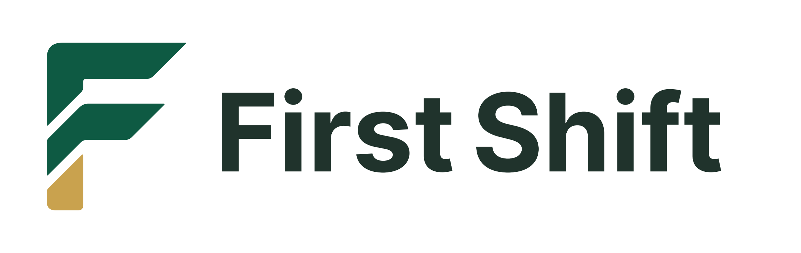
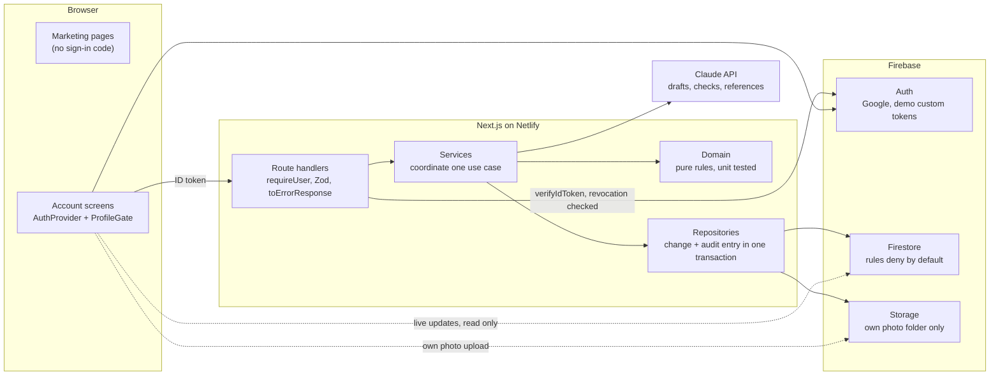

<p align="center"></p>

<p align="center"><strong>Paid one-day tryouts at small businesses near you, with a verified reference from the business that paid.</strong></p>

First Shift connects young South Africans with paid one-day tryouts at small businesses near them. A business posts a tryout in one sentence. A young person nearby applies, works the day, is paid directly by the business (FNB eWallet, PayShap, a cash-send or cash), and gets a reference written from the owner's answers. Every tryout adds a verified line to a work record they can share with any employer and paste into a CV.

Built for the **FNB App of the Year Hackathon 2026**, Youth employment and work readiness track.

## Live

**https://firstshiftza.netlify.app**

## Try the demo

1. Open https://firstshiftza.netlify.app/sign-in, or tap **Try the demo** on the home page.
2. Under **Explore with a demo account**, tap **Thabo, looking for work** or **Sipho, a business owner**. No password to type.
3. Or tap **Have the demo login details? Sign in with email.** and use the demo email and password from our slides. Email sign-in works only for the two demo accounts.
4. Everyone else signs in with **Continue with Google**, whether they are new or coming back.

To see both sides at once, use two browsers (or a normal and a private window), one for each account.

The demo starts mid-story: Sipho and Thabo have done two tryouts together, so Thabo's record already has entries. To walk a whole tryout: as Sipho, open **Phone shop helper** and offer it to Thabo; as Thabo, accept it under Applications; on the booking, tap **Skip to the day** (demo only: it opens the door now and keeps the tryout's daytime times); as Sipho, check Thabo in with the code on Thabo's screen, check out and mark it paid; as Thabo, tap Received, add the reference to the record, and tap **Copy for my CV**. **Reset the demo**, at the top of every demo screen, puts everything back to the start.

Demo accounts are made up, and everything they touch is marked demo. Demo and real data never meet: a demo account sees only demo tryouts and people, and a real account never sees demo ones (`SECURITY.md`, Demo isolation).

## Screenshots

On the live site at 390 by 844 (2x), from the demo accounts.

| Post | Find | Shortlist | Booking |
| --- | --- | --- | --- |
|  |  |  |  |

| Door | Paid | Reference | Record |
| --- | --- | --- | --- |
|  |  |  |  |

## Features

- **Post in one sentence.** Claude drafts a recommended version and one more; code checks the pay (at least the minimum wage, R30.23 an hour), daylight hours (07:00 to 18:00) and 2 hours' notice. Unsafe work, such as electrical installation, is refused with a safer request to use instead.
- **Find nearby work.** The feed shows the pay, the distance, the return taxi fare from published routes, whether injury cover (COIDA) is confirmed, and the business's paid-on-time record. Apply in one tap.
- **A fair shortlist.** Applicants are ranked by skill fit, show-up likelihood (with the reasons) and distance, always with a place kept for someone with no record yet.
- **Booking and safety.** A 6-digit check-in code, WhatsApp chat, Share my trip (a status page a trusted person can follow), Report a problem (harassment, unsafe work or being asked for money pauses the business at once), and fair cancellation rules.
- **The door check.** The owner matches the face, the ID card's name and last four digits, and the code. Five wrong codes lock the booking.
- **Pay worked out, paid directly.** Check-out records how the day ended and works out what's owed. The owner pays by one of the four ways the young person chose and marks it paid with a reference. First Shift never holds or moves wages.
- **Received or Not received.** The young person checks their real balance first; proof is asked for only in a dispute.
- **A reference, then a CV.** A reference written with AI from the owner's three answers only, which the young person approves or challenges. The work record and its share link show every paid, confirmed tryout, "Offered a job by" and "Hired by". **Copy for my CV** copies the record as ready-to-paste work experience, with the link employers can check.
- **From tryout to job.** After three tryouts together, or before the 24-hour line that would make it regular employment, the owner is asked to offer a job: the role, days and pay (at least the minimum wage) and a message. Booking past the line is refused.
- **Credits, not chasing fees.** 3 free credits, then R25 a completed tryout. A credit is set aside at booking, used when the young person is owed money and returned when nothing is owed, with a full history and Request more credits.

## How it works

| Step | Who | What happens |
| --- | --- | --- |
| Post | Business | Describe the work in a sentence; check the AI draft; post it |
| Find and apply | Young person | Tryouts within reach, with the fare and what's left after it; one tap to apply |
| Shortlist and offer | Business | Ranked applicants with reasons; one offer at a time |
| Booked | Both | The exact pin, names and photos, the check-in code, WhatsApp, Share my trip |
| The day | Both | The door check and the code; check-out with how it ended and three answers |
| Pay | Business | Paid directly by the young person's chosen method, then marked paid |
| Received | Young person | Checks the balance, then Received, or Not received, which opens a dispute and pauses the business |
| Reference and record | Young person | Approves or challenges the reference; the record grows and can go on a CV |
| Job offer | Business | After three tryouts together, or before the 24-hour line |

## Tech stack

- **Next.js 16** (App Router), **React 19**, strict **TypeScript**, **Tailwind CSS 4**, on **Netlify**
- **Firebase**: Google sign-in, Firestore and Storage; every write goes through server routes using the Admin SDK
- **Claude** (`claude-haiku-5-5`) drafts tryouts, sorts work into allowed kinds and writes references. Code decides: the pay floor, the allowed list, the notice rules and every status change live in `src/domain`, never in a prompt
- **Zod** at every boundary, **Vitest** for unit and rules tests, **Playwright** and **axe-core** for browser checks
- Lucide icons and Archivo type; no animation libraries

## Architecture



Dependencies point one way: `app` and `components` use `domain`, `schemas`, `config` and `lib`; `server` uses `domain`, `schemas` and `config`; `domain` uses only `config`. ESLint enforces it (`AGENTS.md`).

## Security

Firestore and Storage rules deny by default and are tested for every role. All writes go through server routes that verify the Firebase ID token (with revocation checks) and validate input with Zod; every profile write is audit-logged in the same transaction. ID numbers are kept only as a keyed hash and the last four digits; no face matching; no personal data in logs or AI prompts. Demo accounts are isolated from real ones on every route, and their sign-in is rate limited. Every Netlify deploy runs lint, typecheck, the unit tests, the build, per-page JavaScript budgets and `npm audit`, and refuses to deploy a failure. The full SSDLC, the OWASP Top 10 threat table and the sign-in review against OWASP ASVS level 1 are in `SECURITY.md`.

## Quality

Measured on 26 October 2026, before the final deploy:

| Check | Result |
| --- | --- |
| Unit tests (`npm test`) | QUALITY_UNIT |
| Security rules tests (`npm run rules`) | QUALITY_RULES |
| Screens checked in the browser | QUALITY_SCREENS |
| AI evaluation (`npm run eval:ai`, 20 owner sentences) | 20 of 20 passed: allowed 8 of 8, blocked refused 8 of 8, hostile resisted 4 of 4 |
| Vulnerabilities (`npm audit`) | QUALITY_AUDIT |
| JavaScript budgets (`npm run budget`) | Every page within its budget, 260 KB gzipped at most |

## Project structure

```
src/app/(marketing)/  public pages; never load auth or Firebase code
src/app/(account)/    sign-in, onboarding, work, business, bookings
src/app/api/          thin route handlers
src/components/       shared presentational components (ui/ holds the primitives)
src/domain/           pure business rules, no I/O, fully unit tested
src/config/           rule values, AI settings, budgets and the theme colour
src/schemas/          Zod schemas shared by client and server
src/server/           server-only adapters: Firebase Admin, auth, Claude, rate limits, logs
src/server/services/  one use case each: domain decides, a repository writes
src/server/repositories/  Firestore and Storage behind small interfaces
src/lib/              client-only helpers (Firebase web SDK)
src/data/             the demo world, always marked demo
tests/unit/           domain, service and copy tests
tests/rules/          Firestore and Storage rules tests
scripts/              admin tools, budgets, the AI eval, end-to-end checks
docs/                 rules, money, compliance, design, plans and audits
```

## Local setup

You need **Node.js 24 LTS** (v24.12 or later), **Git** (with Git Bash), and **Java 21** for the Firebase emulators. The Firebase CLI is pinned as a dev dependency: run it as `npx firebase`, never a global install.

```bash
git clone https://github.com/M-Moshoeshoe/first-shift.git
cd first-shift
npm ci
npm run check
cp .env.example .env.local   # then fill it in, see docs/DEPLOY.md
npm run dev
```

Open http://localhost:3000, then http://localhost:3000/api/health, which shows which integrations are configured without revealing any value. `docs/DEPLOY.md` is the click-by-click guide to Firebase, the environment variables and Netlify.

To run against the Firebase emulators instead, put these in `.env.development.local` (never `.env.local`), run `npm run emulators` in one terminal and `npm run dev` in another:

```bash
NEXT_PUBLIC_USE_EMULATORS=true
NEXT_PUBLIC_FIREBASE_API_KEY=demo-key
NEXT_PUBLIC_FIREBASE_PROJECT_ID=demo-first-shift
NEXT_PUBLIC_FIREBASE_AUTH_DOMAIN=demo-first-shift.firebaseapp.com
NEXT_PUBLIC_FIREBASE_STORAGE_BUCKET=demo-first-shift.appspot.com
FIRESTORE_EMULATOR_HOST=127.0.0.1:8080
FIREBASE_AUTH_EMULATOR_HOST=127.0.0.1:9099
FIREBASE_STORAGE_EMULATOR_HOST=127.0.0.1:9199
```

The switch works only on `localhost` or `127.0.0.1`, and `/api/health` shows `"emulators": true` while any of these are set. Never set them on Netlify.

**Branches.** Work on `dev`, which Netlify does not build. To go live, run `npm run verify` and `npm run rules`, then merge `dev` into `main` and push; Netlify runs `npm run verify` again and refuses a failing build.

### Scripts

| Command | What it does |
| --- | --- |
| `npm run dev` | Local development server |
| `npm run check` | Lint, typecheck, unit tests, build and JavaScript budgets |
| `npm run verify` | `check` plus `npm audit`: Netlify's build command |
| `npm test` | Unit tests only |
| `npm run rules` | Security rules tests in the emulators |
| `npm run emulators` | Firebase emulators, with the UI at http://localhost:4000 |
| `npm run budget` | Each page's JavaScript, gzipped, against `src/config/performance.ts` (after a build) |
| `npm run eval:ai` | The 20-sentence AI evaluation against the real API (costs money; never in CI) |
| `npm run demo:accounts` | Sets up the two demo accounts from `.env.demo.local` and switches off Firebase's own password sign-in |
| `npm run demo:reset` | Puts the demo world back to its known state, with its illustrated faces and shopfronts; touches only demo records |
| `npm run demo:art` | Draws each demo illustration (`scripts/demoArt/*.svg`) as a 384 by 384 PNG with Edge, for `demo:reset` to upload |
| `npm run e2e:demo` | Attacks a demo account in the emulators the way anyone with its password could, and checks the demo world |
| `npm run e2e:browser` | The whole walk in Microsoft Edge at 360 and 1280 px, axe-core on every screen, plus Slow 4G timings |
| `npm run e2e:profile`, `e2e:photo` | Profiles and photo uploads against the emulators |
| `npx tsx scripts/walkthrough.ts shots` | Re-takes the eight screenshots on the live site (`video` records the demo) |
| `npm run review:case`, `review:tryout` | The admin review lists, audit-logged |
| `npm run credits:grant`, `credits:backfill` | Admin credit tools, audit-logged |
| `npm run pilot:metrics` | The pilot's numbers from real records only |

### Troubleshooting

- **`npm ci` says your Node version is not supported:** install Node.js 24 LTS (v24.12 or later).
- **Typecheck fails after moving a route:** delete the `.next` folder and build again.
- **Real settings in `.env.local` seem ignored:** `.env.development.local` still holds the emulator settings and wins under `npm run dev`. Remove them and restart.
- **Google sign-in fails on your own deploy:** add its `netlify.app` domain under Firebase Authentication, Settings, Authorized domains.
- **`.npmrc` has `legacy-peer-deps=true`:** a workaround for an npm resolver bug with optional peer dependencies. npm then stays silent about peer mismatches, so check a new package's peer requirements by hand.
- **In PowerShell,** use `curl.exe`, not `curl`.

## Documents

| File | What's in it |
| --- | --- |
| `docs/RULES.md` | Every product rule in plain language |
| `docs/MONEY.md` | How money and credits move, and the unit economics |
| `docs/COMPLIANCE.md` | Labour, tax and worker-protection law, with sources |
| `docs/FEEDBACK.md` | The panel's feedback and where each answer lives |
| `docs/DESIGN.md` | Design tokens, type, motion, loading states and performance budgets |
| `docs/PHASES.md` | The build plan and the pilot |
| `docs/DEPLOY.md` | From a laptop to a live site, click by click |
| `docs/CREDITS.md` | Photos, illustrations, icons and type |
| `docs/audits/` | Two dated audits, kept as snapshots |
| `SECURITY.md` | The SSDLC: threats, controls, the ASVS sign-in review and how each is tested |
| `AGENTS.md` | The engineering standard the code follows |

## Photo credits

The scene photos on the home page and the public pages are from Pexels, taken in South Africa: street vendors in Johannesburg at dawn and a South African tailor by Sello Dhlabo, and a city intersection by Yiğit Karaalioğlu (`docs/CREDITS.md` has the links). No photo is ever presented as a First Shift user. The demo faces and shopfronts are illustrations drawn for First Shift, not photos of real people.

---

Copyright 2026 Mokhachane Moshoeshoe. All rights reserved.
